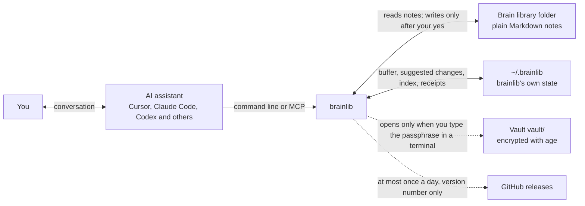
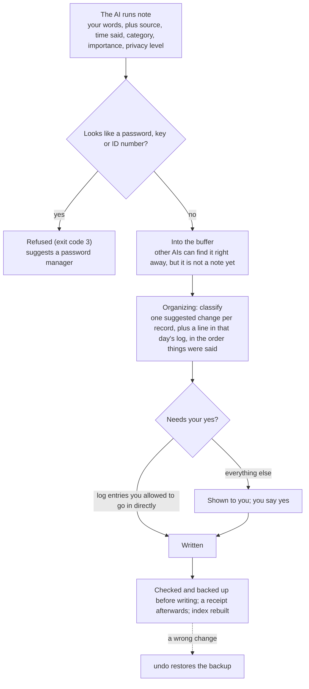
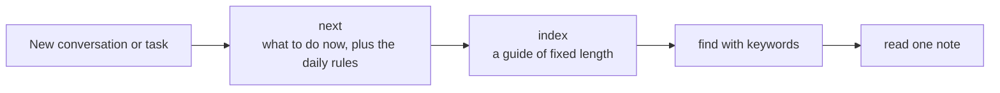
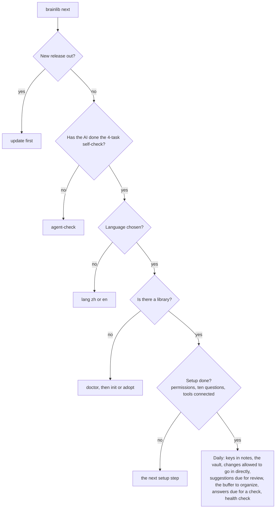
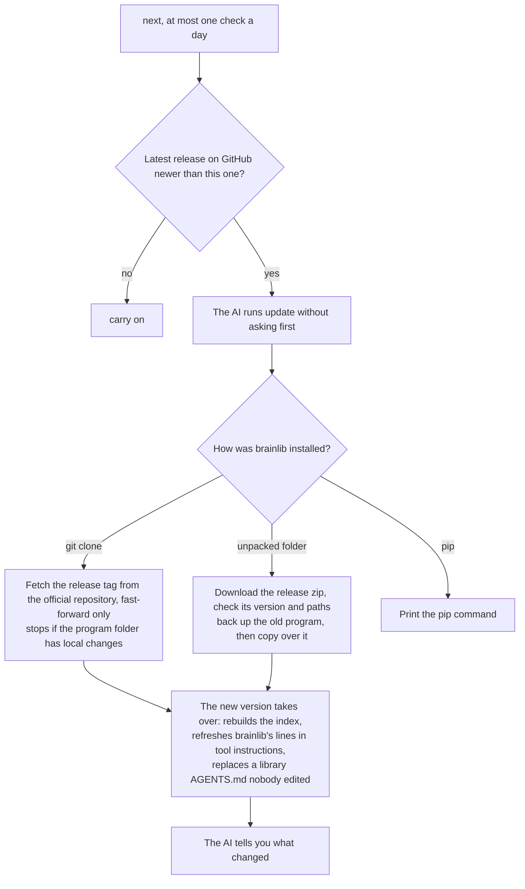

# `brainlib`

**Your own AI brain library. One copy shared by the AI assistants you connect, and it knows you better the longer you use it.**

[中文](README.md)

`brainlib` is a small harness I hacked together. Every time I switched models or started a new project with an AI, I had to explain all the context again from scratch, and agents that ran for a long time lost their long-term memory and started hallucinating.

`brainlib` maintains a "brain library" folder on your own computer. Any local AI agent can work with it, and after each conversation it writes down what it learned, so switching models doesn't lose what your agents knew about you (it's agent-agnostic). It has three modules. The capturer puts your preferences, decisions and the like into a buffer first, each labeled with where it came from. The organizer turns the buffer into suggested changes to the brain library. The maintainer gives the library regular health checks and archives what's outdated.

**Installing takes one sentence.** In Cursor, Claude Code, Codex or a similar tool, send this to the agent.

```text
Please read AGENTS.md at https://github.com/mingweima/brainlib and set up brainlib for me.
```

After that, whenever you start a new agent conversation, have it read what's in the `brainlib` folder first.

> [!IMPORTANT]
> **It only works on a computer.** `brainlib` reads and writes your notes and runs commands on your computer, so it only works with an AI that can operate your machine, such as Cursor, Claude Code or Codex. AIs in a browser or a phone app can't connect; that is by design.

Only installed for real on Mac and Linux so far.

## How it works once installed

At the start of each new conversation, the AI reads a few core pages of the brain library, such as "About me", the way a new colleague reads the handover notes on day one. Other notes are looked up when needed, so the whole library never gets stuffed into the conversation.

When you say something worth remembering, the capturer puts your exact words into the buffer (the AI may call it the inbox when it talks to you), labeled "you said" with the time you said it, to the minute, plus what kind of thing it is and how much it matters. The AI's own guesses are labeled as guesses, and things found online carry their source; only what you said counts as what you meant. Other AIs can find what's in the buffer right away, but it isn't part of your notes yet.

Every so often the organizer turns the buffer into suggested changes and shows them to you, one per record. Nothing goes into your notes until you say yes, and a wrong change can be undone. Everything also goes into the day's log in the order it was said, so you can look up what you said on any day. When you said different things about the same matter, the newest one counts; when you change your mind, it offers to replace the old line and keeps the old wording in brackets. How often this happens, and whether things like a journal can be recorded directly, are up to you during setup.

The guide the AI reads has a fixed length: the most important pages and the latest things you said come first, older ones sink, so it does not grow with the library. Older records can be filtered by category, date or importance.

The maintainer finds pages past their check-again date, broken links, passwords that ended up in notes, and lines in the same note that no longer agree, and asks whether to update or archive them. Every few months it goes over the setup questions with you again, and if what you've been saying lately doesn't match an earlier answer, it asks about that too. All of this comes up the next time you talk to an AI; it never pops up on its own.

## What it looks like

- On Monday you mention in Cursor that you never use exclamation marks. On Wednesday you ask Claude Code to write an email; it checks the brain library first, and the email has no exclamation marks.
- You say "I'm presenting this paper at NeurIPS next month", and that sentence is what it saves. If it guesses the paper is about reinforcement learning, that's saved as a guess.
- A few days later it asks "Add 'export every figure in a paper as vector PDF' to About me?", and it changes the note only after you say yes.
- Last month you said "cluster the standard errors by firm"; today you say "cluster by firm and year instead". It asks "Replace 'cluster by firm' with 'cluster by firm and year'?", and from then on every AI goes by the new one.
- You paste an OpenAI API key and say "remember this for next time". It won't, and suggests a password manager, with only a note of where the key is kept.

## Installing

After sending that sentence, answer its questions. It asks which language you want and where to keep the brain library, then ten multiple-choice questions, for example what it may record, whether to ask before every change, and which topics are sensitive. Finally it asks which AI tools you use and connects them.

Once connected, every new conversation reads the brain library first without you asking. For tools like Claude Code and Codex, it adds a few lines to their global instructions; for tools like Cursor and Trae, it gives you a short text to paste into their settings. Everything it adds is marked and can be removed at any time.

After installing, three things are new on your computer: the `brainlib` program in your home folder (for example `~/brainlib`), the brain library in the folder you chose, and `brainlib`'s own records and the buffer in `~/.brainlib`. Nothing runs in the background; `brainlib` runs only when an AI calls it. Apart from updating itself, it asks you before installing anything or changing any tool's settings.

`brainlib` keeps itself up to date. When the AI runs `brainlib next`, `brainlib` checks GitHub for a new release at most once a day; if there is one, the AI updates right away and then tells you what changed. An update replaces only the `brainlib` program and never touches your notes; the lines `brainlib` added to your tools' instructions are refreshed too, with backups of the old files. If you don't want automatic updates, tell the AI and it will run `brainlib update --off`.

You need Python 3.9 or newer. If you don't have it, the AI asks you first and then helps you install it. age (for the vault) and git are optional.

Before starting, the AI takes a 4-question self-check that the program grades. If it fails, it tells you so and suggests a stronger model, or read-only lookups for now.

On Windows, the automated tests run on every change, but nobody has installed it there for real yet. If you run into problems, please open an issue on GitHub, in English or Chinese.

## Five levels

Each level includes everything in the one before it, and switching levels never changes your notes. At every level, the AIs you connect share the same library.

- **0 Read-only.** Helps the AI understand your notes. It can search and check your notes for problems, and writes nothing. Good for trying it out.
- **1 Capture.** Adds the buffer, so what the AI learns is kept outside your notes and you do the tidying.
- **2 Organize.** Adds suggested changes that apply only after you approve them, each one recorded and undoable. If you allow it, low-risk entries such as a journal can be recorded directly. This is the default, and enough for most people.
- **3 Vault.** Adds an encrypted vault for private content that only you can open.
- **4 Multi-assistant.** Adds MCP and checks you write yourself, for power users with several AIs splitting up the work.

Your starting level depends on how you answer the setup questions, and you can change it at any time.

## Privacy

**What `brainlib` guarantees.**

- Search, read, the index and the MCP interface never return private notes, not even their titles.
- Passwords, secret keys, ID numbers and bank card numbers are refused in notes and edits. Ones already in your notes are hidden when shown to the AI.
- The vault is encrypted with [age](https://github.com/FiloSottile/age). Only you can type its passphrase, in a terminal window, so the AI can't open it. The vault is optional and off by default.
- Change records and check reports never copy your notes. They record only which note changed and who approved it.
- Before sharing your brain library with anyone, you can scan it against your own private word list (real names, company, address and so on), and it passes only with zero matches.
- `brainlib` goes online only to update itself: at most once a day it asks GitHub for the latest version number, and it downloads a new release from GitHub when there is one. The requests carry none of your notes or personal details; GitHub sees only your IP address and the `brainlib` version. You can turn this off.

**A few things it can't do.**

- An AI's own file-reading tools may still be able to read private files that aren't encrypted. `brainlib` tells it not to and ships permission settings for common tools, but the safest place for private content is the vault.
- File names inside the vault are visible.
- Your sync provider can see notes that aren't encrypted.
- What the AI reads is sent to the company behind its model, just as when you use that AI anywhere else.

## FAQ

**How is this different from ChatGPT's built-in memory?** What ChatGPT remembers only helps inside ChatGPT; switch to Cursor and it's gone. The brain library is plain files on your computer, every AI you connect reads the same copy, and each entry says whether you said it or the AI guessed it.

**Does it cost anything? Can I use it at work?** `brainlib` is free; the AI tools you use charge their own prices. Using it yourself is free, and that includes your own work, such as managing your own notes on a work computer. Deploying it for other people, building it into a product or using it to provide a service needs a license from me first.

**I only use ChatGPT, Doubao or Kimi in a browser or on my phone. Can I use it?** No, and that is by design: `brainlib` has to read and write files and run commands on your computer, which an AI in a browser or a phone app can't do. Claude Desktop can connect through MCP (a standard way for AI tools to call outside programs); see [docs/mcp.md](docs/mcp.md).

**Can a cloud agent use it?** Not by default. Only if the brain library is in a sync folder and that agent can really read and write the folder and run `brainlib` commands on the machine it runs on.

**Reading the brain library at the start of every conversation, won't that be slow or use up my quota?** It reads only a few core pages each time and looks up the rest when needed. However big the library gets, each conversation reads those few pages plus whatever it finds.

**Can I use it without existing notes?** Yes, it creates a new library for you. If you already have a folder of Markdown notes (Obsidian, for example), it can use that folder directly without changing a single character. Notes in Notion, Evernote or Apple Notes can't be imported directly yet; if you can export them as Markdown files, it can use the exported files.

**Can I open, edit or delete things myself?** Yes. The notes are ordinary Markdown files that any editor can open. To see what's in the buffer and not yet tidied, ask the AI to list it.

**Can two computers share one library?** Put the brain library in a sync folder such as iCloud or OneDrive, and both computers can read the notes. The buffer and suggested changes you haven't approved yet stay on each computer and don't sync.

**Can I try it without letting it write anything?** One setup question asks whether it may write; choose "read-only". You can change that at any time.

**Can I move over what ChatGPT already remembers about me?** Not automatically yet. You can paste it to the AI and have it saved to the buffer first, then approve it when tidying.

**What if I want to stop using it?** Your notes are still ordinary Markdown files, so you can open them and take them anywhere. To stop the AI from using it, ask the AI to remove the lines it added to each tool (`brainlib connect --tool <tool> --remove`).

## Why I built it

I first built a brain library for myself. Several AIs read it and write to it day to day, and later I turned the parts anyone could use into brainlib. My one requirement was that the whole library could be handed to a brand-new AI at any time, and it could take over after one read. I call this goal cyber-immortality: record my thinking and the way I make decisions completely, so that whatever AI comes next can act the way I would.

## How it works inside

This section is for readers who want to know how it works inside.

### The parts

`brainlib` is a command-line program that uses only Python's standard library and never runs in the background. When an AI calls it from the command line, it does one thing and exits; over MCP, the AI tool starts it and it exits when the tool closes.



The brain library folder holds your notes. `brainlib` adds only a settings file, `.brainlib/config.json`, and a new library also gets an `AGENTS.md` for AIs to read. Everything else `brainlib` keeps lives outside the library in `~/.brainlib`, so putting the library in a sync folder doesn't sync the buffer or suggested changes you haven't approved yet:

```text
~/.brainlib/
  global.json                 language, AI self-check results, update checks
  registry.json               the libraries brainlib knows, and which one is the default
  libraries/<id>/state/       the buffer inbox/, suggested changes proposals/, receipts receipts/, backups made before changing notes backups/, setup answers
  libraries/<id>/out/         the index index.json, all records records.json, health report reports.json
  backups/                    backups made before changing tool instructions or updating the program
```

### From what you said to a note



- There are six kinds of source: your exact words, a view you clearly stated, something taken from your own writing (with the file name), the AI's inference, the AI's guess, and outside material (with its source). Only the first three count as what you meant.
- Every record carries the time it was said, to the minute, and the newest statement about the same thing counts. When the AI records a new statement with `--replaces "<a few words of the old one>"`, organizing produces a replace-this-line suggestion and keeps the old wording in brackets at the end of the new line. If the old statement is still in the buffer, only the new one goes into the note and the old one stays in the log. An older line that merely looks alike, without `--replaces`, is only pointed out in the suggestion, never replaced automatically.
- Writes are checked first. Replacing a whole note requires that the note hasn't changed since the suggestion was made; replacing a line requires that the line is still there. If not, nothing is written and the suggestion is marked out of date (exit code 5). A change that needs your yes is not written without your words (exit code 4).
- Receipts record which note changed, its hashes before and after, and who approved, never the content.
- Only one `brainlib` command runs at a time; the others wait. A lock left behind by a crashed process is recognized and cleared by the next command.

### How the AI finds what it needs



- Pages come in four tiers: L0 core pages such as About me, read every time; L1 entry pages; L2 regular notes; L3 the archive. Records use the same tiers: important records not yet filed are L0, other unfiled ones L1, records filed into notes L2, archived ones and older log entries L3.
- `index` has a fixed length: core pages, important records not yet filed (at most 10), entry pages, the last 7 days of log, recent records (at most 20, newest said first), and statements that may be out of date (at most 5). Older ones are found with filters such as `index --since`, `--category` or `--importance`.
- Private notes never show up in search, read, the index or MCP, not even their titles. Keys found inside ordinary notes are masked when read.

### next gives one thing at a time

Before every task the AI runs `brainlib next`. It goes through the checks below in order, names only the first thing that needs doing, and adds the daily rules.



The output always has the same shape: `NEXT` is what to do, `WHY` is the reason, `RUN` lines are commands to run, `SAY TO USER` is what to tell you, and `THEN` says to run `next` again afterwards. Small models can follow it line by line.

### Updates



To stop automatic updates, run `brainlib update --off` or set the environment variable `BRAINLIB_NO_UPDATE_CHECK=1`. Updating by hand works too: after a `git pull` or a replaced folder, the new version takes over the next time `next` runs.

### Exit codes

Every error prints two lines: `ERROR` says what happened and `FIX` says what to do. Exit codes are fixed: 0 success; 1 findings, for example the health check found problems; 2 wrong usage; 3 stopped by the privacy check; 4 needs your yes; 5 conflict, for example the note changed in the meantime.

Details of the note format and source labels are in `spec/`; security considerations are in [docs/threat-model.md](docs/threat-model.md).

## Files

```text
AGENTS.md          Entry point for AI assistants (Chinese; English in AGENTS.en.md)
brainlib.py        Launcher for macOS/Linux; on Windows use brainlib.cmd
brainlib/          The program (Python standard library only)
skills/            Task guides: setup, onboarding, capture, organize, privacy, maintenance, and a writing guide (Chinese only)
spec/              Note format, provenance labels, command conventions
docs/              Status, roadmap, threat model, MCP setup
templates/         Permission templates for AI tools
examples/          Two fictional example libraries
tests/             Tests
```

## License

`brainlib` is released under the [PolyForm Noncommercial License 1.0.0](LICENSE). Individuals can use, modify and share it free of charge for personal use, research, study and hobby projects, and so can charities, schools, public research organizations and government institutions.

**Additional permission.** The developer also permits individuals to use `brainlib` free of charge in their own work, for example to manage their own notes on a work computer. Deploying it for others, building it into a product or using it to provide a service still requires a commercial license.

Any other commercial use is not allowed, and the licensor keeps all commercial rights. For a commercial license, contact the developer through GitHub (github.com/mingweima/brainlib). This is a summary; the LICENSE text and the additional permission above govern.

Developer Mingwei Ma, Capibara Capital.
