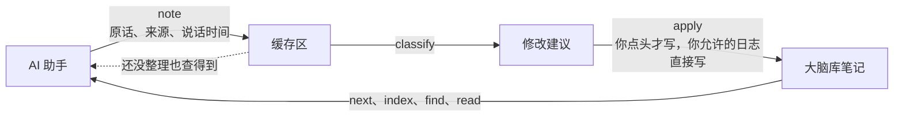

# `brainlib`

**你自己的 AI 大脑库。你接上的 AI 助手共用一份，越用越懂你。**

[English](README.en.md)

`brainlib` 是我手搓的一个 harness 小工具。起因是我平时用 AI，每换一个模型或者开一个 project，都得从头交代一遍所有的 context，而且 agent 用久了也会失去长记忆，开始幻觉。

`brainlib` 做的事情就是在你自己电脑上 maintain 一个「大脑库」文件夹，不管用什么本地 AI agent，都可以和它交互，每次和你聊完把新学到的记下来，所以换模型都不会丢失你的所有 agent 记忆（agent-agnostic）。它分三个模块。capturer 把你说过的偏好、决定这些先放进一个缓存区，每条标清来源；organizer 把缓存区归类成对大脑库的修改建议；maintainer 定期给大脑库做体检归档。

**安装只要一句话。** 在 Cursor、Claude Code、Codex 这类工具里，把下面这句话发给 agent 就行。

```text
请读 https://github.com/mingweima/brainlib 的 AGENTS.md，帮我装好 brainlib
```

装的时候 agent 会帮你接上工具，以后每个新对话会自动先读大脑库；Cursor、Trae 这类，要把 agent 给你的一段话粘进设置。

> [!IMPORTANT]
> **只有在电脑上才能用。** `brainlib` 要在你的电脑上读写笔记、运行命令，所以只能接 Cursor、Claude Code、Codex 这类能操作你电脑的 AI；网页版和手机上的 AI 接不上，这是设计如此。

只在 Mac 和 Linux 上实际装过。

## 装好以后怎么转

每开一个新对话，AI 先读大脑库里的几页核心页，比如《关于我》，就像新同事入职先看交接文档。其余的笔记用到时再查，不会把整个库塞进对话。

你说了值得记的话，capturer 把原话放进缓存区（AI 跟你说话时可能叫它收件箱），标上「你说的」和你说这句话的时间，精确到分钟，再标上它属于哪一类、要不要紧。AI 自己的推测标成「助手推测」，网上查来的标出处，只有你说的才算你的意思。缓存区里的东西，别的 AI 马上就能查到，只是还不算正式笔记。

organizer 隔一阵子把缓存区整理成修改建议拿给你看，一条记录一条建议，你点头才写进笔记，改错了能撤回。每件事还会按说话时间写进当天的日志，翻日志就知道哪天说过什么。同一件事你前后说得不一样时，以最新的为准；你改了主意，它会提议把旧的那句换掉，旧说法留在括号里备查。多久整理一次、日记这类要不要直接记，装的时候由你选。

AI 看的目录长度固定，最重要的几页和最近说的事在上面，旧的往下沉，库再大也不会变长。要找旧的，可以按分类、日期、重要性筛出来。

maintainer 会找出过了复查日期的页、断掉的链接、误存进笔记的密码，以及同一篇里前后对不上的说法，问你要不要更新或者归档。装的时候你答过的选择题，它隔几个月会再跟你确认一次；你最近的说法和当初的选择对不上，它也会问。这些都是在你下次和 AI 聊天时提，它不会自己弹出来找你。

## 用起来是什么样

- 周一你在 Cursor 里随口说「我写东西不爱用感叹号」。周三你在 Claude Code 里让它写封邮件，它先查了大脑库，写出来就没有感叹号。
- 你上个月说参考文献用 APA 格式，这个月改口说以后用 Chicago。它会问你要不要把笔记里的 APA 换成 Chicago，你说好，之后哪个 AI 帮你排参考文献都用 Chicago。
- 三月你在 Codex 里让它记下审稿人对第二章的意见。九月你在 Cursor 里问「审稿人当时对第二章说了什么」，它从大脑库里找出那条记录，还告诉你是三月哪天记的。

## 怎么装

发了上面那句话以后，回答它的问题就行。它先问你用什么语言、大脑库放在哪，再问十道选择题，比如它可以记哪些东西、改笔记前要不要每次都问你、哪些话题算敏感。最后问你平常用哪些 AI 工具，帮你都接上。

接上以后，每个新对话会自动先读大脑库，不用你每次交代。Claude Code、Codex 这类工具，它会在全局说明里加几行；Cursor、Trae 这类，它会给你一段话，请你粘到设置里。加的内容都带标记，随时能去掉。

装完你电脑上会多出三样东西。`brainlib` 程序放在你的主目录下，比如 `~/brainlib`；大脑库放在你选的文件夹；`brainlib` 自己的记录和缓存区放在 `~/.brainlib`。它不在后台常驻，只在 AI 调用时运行。除了 `brainlib` 自己的更新，要装什么、改哪个工具的设置，它都会先问你。

`brainlib` 会自己保持最新。AI 运行 `brainlib next` 时，它每天最多去 GitHub 看一次有没有新的正式版；有的话 AI 直接更新，再告诉你改了什么。更新只换 `brainlib` 程序，不动你的笔记；工具说明里 `brainlib` 加的那几行会跟着刷新，旧文件都留了备份。不想自动更新，跟 AI 说一声就行，它会运行 `brainlib update --off`。

电脑上要有 Python 3.9 或更新的版本，没有的话 AI 会先问你，再帮你装。保险箱要用的 age 和 git 都是可选的。

AI 开始前会先做 4 道小题的自测，由程序判分。没通过的话，它会照实告诉你，建议换个更强的模型，或者先只做只读查询。

Windows 上每次改动都会自动跑一遍测试，但还没有人实际装过。遇到问题请在 GitHub 上提 issue，中文英文都行。

## 五个档位

每一档都包含前一档，换档不用改笔记。不管在哪一档，你接上的几个 AI 都共用这一个库。

- **0 只读。** 帮 AI 读懂你的笔记，能查找，能检查笔记里的问题，什么都不写。适合先试试。
- **1 记录。** 加上缓存区，AI 学到的东西先放在笔记外面，由你自己整理。
- **2 整理。** 加上修改建议，你批了才改，每次改动都留记录，能撤回。日记这类低风险的，你允许的话可以直接记。默认就是这一档，大多数人用它就够了。
- **3 保险箱。** 加上加密保险箱，私密内容只有你能打开。
- **4 多助手。** 加上 MCP 接入和你自己加的检查程序，适合好几个 AI 分工干活的重度用户。

从哪一档开始，看你在选择题里怎么答，以后随时能改。

## 隐私

**`brainlib` 保证的事。**

- 查找、阅读、目录和 MCP 接口都不返回私密笔记，连标题都不显示。
- 记录和修改里出现密码、密钥、身份证号、银行卡号，一律拒收。笔记里原本存着的，拿给 AI 看时会遮住。
- 保险箱用 [age](https://github.com/FiloSottile/age) 加密。口令要你本人在命令行窗口里输入，AI 打不开。保险箱是可选的，默认不开。
- 改动记录和检查报告只记改了哪篇、谁同意的，不抄笔记内容。
- 要把大脑库分享给别人之前，可以用你自己的私密词表（真名、公司、住址这些）扫一遍，一处都没有才放行。
- `brainlib` 自己联网只为了更新。它每天最多自己向 GitHub 查一次最新的版本号，你或 AI 手动运行 `brainlib update` 时也会查；有新版本时从 GitHub 下载。请求里不带你的笔记和任何个人信息，GitHub 看得到的只有你的 IP 地址和 `brainlib` 的版本号。不想要可以关掉。

**有几件事它做不到。**

- AI 自带的读文件功能，也许能直接读到还没加密的私密文件。`brainlib` 会要求它别读，也给常见工具准备了权限设置，最稳的还是把私密内容放进保险箱。
- 保险箱里的文件名看得见。
- 同步盘的服务商能看到没加密的笔记。
- AI 读到的内容，会像你平时用 AI 一样，发给它背后的模型公司。

## 常见问题

**和 ChatGPT 自带的记忆有什么不一样？** ChatGPT 记住的东西只在 ChatGPT 里有用，换到 Cursor 就没了。大脑库是你电脑上的普通文件，接上的几个 AI 读的是同一份，每条还标着是你说的还是 AI 猜的。

**要花钱吗？上班能用吗？** `brainlib` 不收钱，你用的 AI 工具照它们自己的价格收费。它是开源的（Apache License 2.0），个人和公司都能免费用，部署给别人用、做进产品或者拿来提供服务也不用找我拿授权。

**我只用网页版或手机上的 ChatGPT、豆包、Kimi，能用吗？** 接不上，这是设计如此。`brainlib` 要在你的电脑上读写文件、运行命令，网页和手机上的 AI 做不到。Claude 桌面版可以通过 MCP（AI 工具调用外部程序的一种标准接口）接上，见 [docs/mcp.md](docs/mcp.md)。

**云上的 agent 能用吗？** 默认接不上。只有大脑库放在同步盘里，而且那个 agent 真能读写这个文件夹、能在它那台机器上运行 `brainlib` 命令时，才接得上。

**每次都先读大脑库，会不会变慢、多费额度？** 每次只读几页核心页，别的用到时再查。库再大，每次读的也就是这几页，加上查到的几篇。

**没有现成的笔记能用吗？** 能，它会帮你新建一个。已经有 Markdown 笔记文件夹的（比如 Obsidian），可以直接接上，接入时一个字都不改。Notion、印象笔记、备忘录里的还不能直接导入，能导出成 Markdown 文件的，导出来就能接。

**我能自己打开看、改、删吗？** 能。笔记就是普通的 Markdown 文件，用什么编辑器都能打开。缓存区里还没整理的，可以让 AI 列给你看。

**两台电脑能共用一个库吗？** 可以把大脑库放进 iCloud、OneDrive、坚果云这类同步盘，两台电脑都能读到笔记。缓存区和还没批的修改建议存在各自的电脑上，不会跟着同步。

**想先试试，不让它写东西？** 装的时候有一道题问它能不能写，选「只读」就行，以后随时能改。

**ChatGPT 里已经记住的东西能搬过来吗？** 暂时不能自动导入。可以把那些内容复制给 AI，让它先记进缓存区，整理时再由你确认。

**不想用了怎么办？** 笔记还是普通的 Markdown 文件，照样能打开、能带走。请 AI 把加在各个工具里的那几行去掉就行（`brainlib connect --tool <工具> --remove`）。

## 我为什么做它

我先给自己建了一个大脑库，平时几个 AI 都读它、往里记，后来把能通用的部分整理成了 `brainlib`。我对它的要求是整个库随时能交给一个全新的 AI，它读一遍就能接手。我管这个目标叫「赛博永生」，意思是把我的想法和做决定的方式记全，以后不管换成哪个 AI，都能照我的方式办事。

## 机制和运行逻辑

这一节写给想弄清楚里面怎么运转的人。

`brainlib` 是一个命令行程序，只用 Python 标准库，不在后台常驻。AI 从命令行调它，它做完一件事就退出；通过 MCP 接的时候，由 AI 工具把它启动起来，工具关了它也就退出了。下图里每个箭头都是 AI 运行的一条 `brainlib` 命令。



大脑库文件夹里放的是你的笔记。`brainlib` 只往里加一个设置文件 `.brainlib/config.json`，新建的库还会有一份写给 AI 看的 `AGENTS.md`。缓存区、修改建议、索引、回执和备份都放在库外的 `~/.brainlib`，所以把库放进同步盘，也不会把还没批的东西同步过去。保险箱 `vault/` 用 age 加密，只有你在终端里输口令才打开。`brainlib` 每天最多去 GitHub 查一次版本号，不传别的。`~/.brainlib` 里的东西如下。

```text
~/.brainlib/
  global.json                 语言、AI 自测结果、更新检查
  registry.json               登记过的大脑库，以及哪个是默认
  libraries/<库编号>/state/    缓存区 inbox/、修改建议 proposals/、回执 receipts/、改笔记前的备份 backups/、开场题答案
  libraries/<库编号>/out/      索引 index.json、全部记录 records.json、体检报告 reports.json
  backups/                    改工具说明、换库内 AGENTS.md、更新程序之前的备份
```

### 写入

- 每条记录是你的原话，带来源、说话时间、分类、重要性和私密等级。像密码、密钥、证件号的不收（退出码 3），会建议放进密码管理器；其余的进缓存区，别的 AI 马上查得到，但还不算笔记。
- 来源分六种，分别是你的原话、你明确说过的看法、从你自己写的东西里摘的（要写文件名）、AI 的推断、AI 的猜测、外部资料（要写出处）。只有前三种算你的意思。
- 每条记录带说话时间，精确到分钟。同一件事以最新的说法为准。记新说法时加 `--replaces "<旧说法里的几个词>"`，整理时会生成「替换这一行」的建议，旧说法留在新行末尾的括号里；旧说法要是还在缓存区没整理，就只有新说法进笔记，旧的留在日志里。字面像、但没加 `--replaces` 的旧行，只在建议理由里提一句，不会自动替换。
- 整理时每条记录生成一条修改建议，另按说话时间写进当天的日志。你允许直接记的（比如日志）直接写，其余拿给你看，你说可以才写。
- 写入前会核对。整篇替换要求笔记在提建议之后没被改过，替换一行要求那一行还在，对不上就不写，这条建议标成过时（退出码 5）。要你点头的改动，没有你的原话就不写（退出码 4）。
- 写之前先备份，写完留回执、重建索引，改错了用 `undo` 还原。回执只记改了哪篇、改前改后的哈希值、谁批的，不抄笔记内容。
- 同一时间只跑一条 `brainlib` 命令，其余的排队等。进程意外退出留下的锁，下一条命令会认出来作废。

### 读取

AI 开始新对话或新任务时，先用 `next` 看下一步做什么和日常规则，再看 `index` 这份长度固定的目录，然后用 `find` 查关键词，用 `read` 读一篇笔记。

- 页面分四层。L0 是核心页，比如《关于我》，每次都读；L1 是入口页；L2 是普通笔记；L3 是归档。记录也分这四层，还没整理的重要记录在 L0，其余还没整理的在 L1；整理进笔记的跟着所在的页走，《关于我》里的是 L0，普通笔记里的是 L2；归档区里的和 14 天前的日志在 L3。
- `index` 的长度固定，依次是核心页、还没整理的重要记录（最多 10 条）、入口页、最近 7 天的日志、最近的记录（最多 20 条，按说话时间从新到旧）、可能过时的说法（最多 5 条）。更早的用 `index --since`、`--category`、`--importance` 这类条件筛。
- 私密笔记在查找、阅读、目录和 MCP 里都不出现，连标题都不显示。普通笔记里夹着的密钥，读出来时会打码。

### next 每次只给一件事

AI 每开始一件事，先运行 `brainlib next`。它按下面的顺序找出第一件该做的事，只说这一件，后面附上日常规则。

1. 程序刚换成新版本，就让新版本接手，告诉你改了什么。
2. 有新版本，先 `update`。同一个新版本再次提到时，只在这一步上面提醒一句，免得更新出了错把别的事都卡住。
3. AI 没做过 4 道题的自测，先 `agent-check`。
4. 没选语言，先 `lang zh` 或 `lang en`。
5. 没有大脑库，先 `doctor`，再 `init` 或 `adopt`。
6. 装机三步没做完，即权限、十道题、接上工具，就做下一步。
7. 都做完了才轮到日常的事，包括笔记里的密钥、保险箱、可以直接记的改动、该审阅的建议、待整理的缓存区、该复查的答案和体检。

输出的格式是固定的。`NEXT` 是要做的事，`WHY` 是原因，`RUN` 是要运行的命令，`SAY TO USER` 是要对你说的话，`THEN` 提醒做完再运行一次 `next`。小模型照着一行行做，也不容易乱。

### 自动更新

`next` 每天最多查一次 GitHub 上最新的正式版，比本机新就让 AI 运行 `update`，不用先问你。git 克隆的只从官方仓库快进到发布标签，程序目录有本地改动就停下；解压的文件夹下载发布包，核对版本号和路径，先备份旧程序再覆盖；pip 装的给出 pip 命令。新版本接手时重建索引，刷新各工具说明里 `brainlib` 那几行，换掉没人改过的库内 `AGENTS.md`，改之前都先备份，然后 AI 告诉你更新了什么。

不想自动更新，运行 `brainlib update --off`，或者设环境变量 `BRAINLIB_NO_UPDATE_CHECK=1`，两种办法都只停掉去 GitHub 查的那一步。手动更新也行，不管是 `git pull` 还是换了文件夹，下一次运行 `next` 时新版本都会自己接手。从备份退回旧版本以后，它不会再自己装回刚退掉的那个版本，更新的版本出来时照常更新。同一台电脑上有两份 `brainlib` 时，每份只改指向自己或者指向已删掉的那份的地方；删掉其中一份以后，另一份下次运行时会把指向它的地方接过来。连外层文件夹一起删掉的，它分不清是删了还是盘没插上，就先不动。

### 退出码

每个错误都打印两行，`ERROR` 说出了什么事，`FIX` 说怎么办。退出码也是固定的，0 成功；1 有发现，比如体检查出了问题；2 用法不对；3 被隐私检查拦下；4 要你点头；5 冲突，比如笔记在这期间被改过。

笔记格式和来源标记的细节见 `spec/`，安全上的考虑见 [docs/threat-model.md](docs/threat-model.md)。

## 文件结构

```text
AGENTS.md          给 AI 助手的入口说明（中文；英文版 AGENTS.en.md）
llms.txt           给大模型和 agent 看的项目简介
brainlib.py        mac/Linux 运行入口；Windows 用 brainlib.cmd
brainlib/          程序本身（只用 Python 标准库）
skills/            七份任务说明：安装、问答、记录、整理、隐私、维护、说人话（只有中文）
spec/              笔记格式、来源标记、命令约定
docs/              现状、路线图、威胁模型、MCP 接入
templates/         AI 工具的权限模板
examples/          两个虚构的示例库
tests/             测试
```

## 许可证

`brainlib` 是开源软件，从 v0.2.3 起采用 [Apache License 2.0](LICENSE)。个人和公司都可以免费使用、修改和分发，商用也可以，不用另外拿授权。分发时要带上 LICENSE 和 [NOTICE](NOTICE)，NOTICE 里写着开发者。v0.2.2 及更早的版本仍按发布时的 PolyForm Noncommercial License 1.0.0。

开发者 Mingwei Ma，Capibara Capital。
